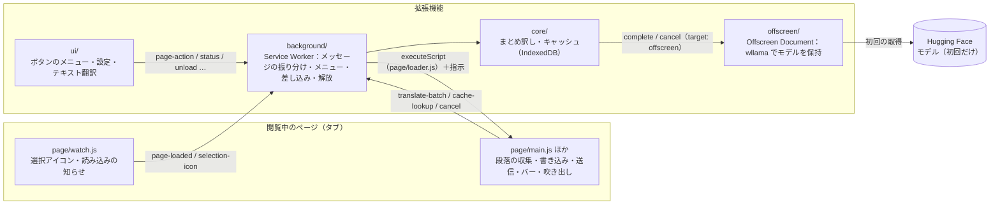

# アーキテクチャ

更新日：2026-11-09

## 用語

このリポジトリの文書・コメントは、一般の技術用語とコードの識別子で書く。独自の呼び名を作らない（[設計方針](11_設計方針.md)「用語」）。

| 用語 | 意味 | C# で近いもの |
| --- | --- | --- |
| Service Worker（`background/`） | 拡張機能の常駐部分。メッセージを振り分け、翻訳の中身を動かす。数十秒使わないと止まり、次のメッセージで起き直す（メモリーの変数は消える） | 必要なときに起動する Windows サービス |
| Offscreen Document（`offscreen/`） | 画面に出ない拡張機能のページ。WebGPU・WASM を使えるので、ここでモデルを保持する。拡張機能につき1つ | モデルを抱えたワーカープロセス |
| content script（`page/`、ページ側） | 閲覧中のページに差し込むスクリプト。ページの DOM を読んで書き換える。ページ自身のスクリプトとは別の世界（isolated world）で動く | 対象アプリに注入するアドイン |
| メッセージ | 部品の間の `chrome.runtime.sendMessage`・`chrome.tabs.sendMessage`。`{ type, ... }` を送り、返事を受け取る | 名前付きパイプのメッセージ |
| 段落 | ページの見た目の段落（ブロック要素）ごとにまとめた文。1段落を1行として訳す | — |
| バッチ | まとめて1回で訳す段落の組（8行・400字まで）。コードでは `chunk` | バッチ |
| キャッシュ | 一度訳した文と訳文の組（`core/cache.js`、IndexedDB） | キャッシュ |
| マーカー | 段落の中の要素をモデルに渡すための `<a1>…</a1>`・`<c1>…</c1>`・`<v1/>`（`shared/markup.js`） | — |

## 実行時の全体像



- ページの文字が通る道は「ページ側 → Service Worker → Offscreen Document」だけ。外へ出るのは、初回のモデルの取得（Hugging Face）だけ。
- ページ側は、訳すと決めたとき（ボタン・メニュー・アイコン・同じサイトの自動翻訳）にだけ差し込む。すべてのページに入るのは小さな `page/watch.js` だけ。

## 採用している技術

| 物 | 使い方 | 採った理由 | 版 |
| --- | --- | --- | --- |
| PLaMo 3 Translate（GGUF、Q4_K_M） | 翻訳モデル。0.8B が既定、2B も選べる | Android アプリと同じ。53言語 | Hugging Face のコミットを固定（`docs/00`「固定した版」） |
| wllama | llama.cpp の WASM 版。Offscreen Documentでモデルを読み込み、WebGPU か CPU（WASM）で生成する | PLaMo 3 を読める唯一のブラウザー向け推論（WebLLM・transformers.js は非対応。2026-11-09） | 3.13.0 を同梱 |
| WebGPU | GPU で推論する | CPU 8スレッドより約2倍速い | ブラウザー任せ |
| OPFS | モデルの保存（wllama が行う） | 初回だけ取得し、以後は数秒で読み込む | — |
| IndexedDB | 訳文のキャッシュ（最大2万件） | Service Workerが止まっても、ブラウザーを閉じても残る | — |
| `chrome.offscreen` | Offscreen Documentを作る・閉じる | Service Workerは WebGPU・長い処理に向かない | Chrome 109 以降 |
| `chrome.scripting` | ページ側の差し込み | 訳すと決めたページにだけ入れる | — |
| `chrome.storage.sync` / `local` / `session` | 設定 / PCごとの調整と調整の結果 / タブごとの自動翻訳・最後に使った時刻・テキスト翻訳への受け渡し | — | — |
| `chrome.alarms` | 1分おきの未使用の見回り | Service Workerが止まっていても起こせる | — |
| COOP/COEP（manifest） | 拡張機能のページを分離し、WASM のマルチスレッドを有効にする | CPU で動かすときに速くなる | — |
| Node（`node:test`）・CDP | 単体試験、Brave を操作する通しの試験・速さの測定 | ビルド不要で、本物の Brave で確かめられる | Node 24 |

ビルドの道具は使わない。拡張機能のフォルダーをそのまま読み込む。

## 部品と依存

```text
extension/
├── manifest.json
├── background/   Service Worker（ES モジュール）
│   ├── main.js     入口。起動時の準備とメッセージの振り分け（handlers の表）
│   ├── menus.js    右クリックのメニュー
│   ├── pages.js    ページへの差し込み・ページの操作・同じサイトの自動翻訳・テキスト翻訳のページを開く・バッジ
│   ├── idle.js     未使用時の解放（1分おきの見回り）
│   ├── config.js   設定の読み出しと移し替え
│   └── logs.js     調査用のログ
├── core/         翻訳の中身（Service Workerで動く）
│   ├── translator.js  まとめ訳し・1つの文章・複数行（テキスト翻訳）
│   ├── cache.js       訳文のキャッシュ（メモリー＋IndexedDB）
│   └── engine.js      Offscreen Documentへのインターフェース（作成・生成・取り消し・状態・解放）
├── offscreen/    Offscreen Document
│   └── offscreen.js   wllama の読み込み（GPU／CPU）と生成（逐次受け取り・打ち切り・取り消し）
├── page/         ページ側
│   ├── watch.js    すべてのページに入る通常のスクリプト（選択の「訳」アイコン、読み込みの知らせ）
│   ├── loader.js   差し込む読み込み役。page/main.js を import し、読み込み終わるまで待たせる
│   ├── main.js     指示を受けるハンドラー。ページ全体・選択した段落・表示の切り替え・終了・書き換えの監視
│   ├── dom.js      要素の判定（行の中の要素・訳さない要素・拡張機能自身の要素）
│   ├── collect.js  段落の範囲の集め方・項目のグループ
│   ├── paragraph.js 段落の中身を読む（要素の分類 roleOf、トークン列・隠す要素・訳文を置く場所）
│   ├── write.js    訳文の木を DOM にする・書き込み・元に戻す
│   ├── queue.js    送信・キャッシュの先置き換え・訳し終わった行の途中表示・取り消し
│   ├── priority.js 訳す順番の点数（位置・場所・段落の性質・マウス）
│   ├── bar.js      上部のバー
│   ├── bubble.js   吹き出し・通知
│   ├── state.js    ページ側の状態と、送信・ログの道具
│   └── page.css    訳文の表示の切り替え・吹き出しの見た目
├── shared/       どこからでも使う物（純粋な関数は Node で試験する）
│   ├── markup.js   段落のマーカーの文法（encode・decode）
│   ├── text.js     訳す価値の判定・訳されていない行・長文の分割・バッチ・生成の打ち切り・サイトの判定
│   ├── prompt.js   PFML3 のプロンプト・生成の上限
│   ├── messages.js メッセージの名前の一覧
│   └── settings.js 設定の既定値・選択肢（52言語）・状態の文
├── ui/           ボタンのメニュー（popup）・設定（options）・テキスト翻訳（translate）・共通の見た目
└── vendor/wllama/
```

依存の向き：`ui`・`page` → `shared`。`background` → `core` → `shared`。`offscreen` → `shared`・`vendor`。`core` と `offscreen` はメッセージでしかつながらない（別のページで動くため）。

ページ側を ES モジュールにする仕組み：content script は直接モジュールにできないので、`page/loader.js`（通常のスクリプト）を `executeScript` で差し込み、そこから `import(chrome.runtime.getURL('page/main.js'))` する。読み込みの Promise を最後の式にしておくと、`executeScript` が読み込みの終わりまで待つので、Service Workerは差し込んだ直後に指示を送れる。import するファイル（`page/*.js`・`shared/*.js`）は `web_accessible_resources` に入れる。ページの CSP（GitHub など）の下でも動くことを、CSP を付けた試験ページで確かめた（`tools/e2e.mjs`）。

## メッセージの一覧

名前は `shared/messages.js` の `MSG`。主なものだけ挙げる。

| 送る側 → 受ける側 | メッセージ | 中身 |
| --- | --- | --- |
| ページ → Service Worker | `translate-batch` | バッチを訳す。`{ texts, id }` → `{ results, stats: { requests, fallback, tokens, loadMs }, model }`（`tokens` は生成したトークン数、`loadMs` はモデルの読み込みの待ち。バーの速さに使う）。取り消されたら `{ cancelled: true }` |
| ページ → Service Worker | `cache-lookup` | キャッシュにある訳をまとめて引く。`{ texts }` → `{ results: (訳 or null)[] }` |
| ページ → Service Worker | `cancel` | 古くなったバッチを取り消す。`{ id }` |
| Offscreen Document → Service Worker → ページ | `partial` → `show-partial` | まとめ訳しの生成の途中。訳し終わった行を、バッチの何行目かに戻してページへ渡す |
| 設定画面 → Service Worker | `cache-stats` | 訳文のキャッシュの件数・大きさと、ブラウザーの中の使用量の合計 |
| ページ → Service Worker | `page-state` | 表示（trans・both・orig）を知らせる。同じサイトの自動翻訳に使う |
| ページ・テキスト翻訳 → Service Worker | `translate-one` | 1つの文章を訳す。`{ text, source?, target?, lines? }`（target はテキスト翻訳の訳文の言語。既定は日本語） |
| watch.js → Service Worker | `page-loaded` / `selection-icon` | ページの読み込み（文書の種類を含む）/ 「訳」アイコンが押された |
| ポップアップ → Service Worker | `page-kind` | タブの文書が内蔵ビューアで表示するもの（PDF など）か |
| 画面 → Service Worker | `page-action` / `switch-model` / `status` / `unload` / `cache-clear` / `logs-get` | ボタンのメニュー・設定画面の操作 |
| 設定画面 → Service Worker | `tune` / `tune-stop` / `speed-test` | このPCに合わせる / 途中でやめる / 今の設定で測る（`background/tune.js`） |
| Service Worker → 設定画面 | `tune-progress` | 調整の途中経過（今測っている設定と、それまでの結果の表） |
| Service Worker → ページ | `toggle` / `start` / `stop` / `retranslate` / `translate-selection` / `translate-selected-paragraphs` / `notice` / `get-state` | ページの操作 |
| Service Worker → Offscreen Document | `complete` / `status` / `cancel`（`target: 'offscreen'`） | 生成・状態・取り消し |
| Offscreen Document → Service Worker | `local-progress` / `log` | モデルの取得の進み具合 / 調査用のログ |

同じ `chrome.runtime.sendMessage` はService WorkerとOffscreen Documentの両方に届く。Offscreen Document宛ては `target: 'offscreen'` を付け、Service Workerはそれに答えない（先に答えると、Offscreen Documentの返事より先に届いてしまう）。

## 処理の流れ

### ページ全体

1. ボタンのメニュー（`page-action`）、`Alt+T`、右クリックから、Service Workerがページへ `page/loader.js` を差し込み、`toggle` か `start` を送る。
2. ページ側が段落を集め（`collect.js`。段落の中身は `paragraph.js` がマーカー付きの1行にする。流れと決まりは [設計方針](11_設計方針.md)）、画面内の段落を覚えて計測を始め、表示のクラスを付け、上部のバーを出す。
3. キャッシュをまとめて引き（`cache-lookup`）、ある分をすぐ置き換える。残りを訳を待つ列に入れる。
4. 見えている順に8行・400字までのバッチを作り、設定の同時実行数（既定4）まで同時に `translate-batch` で送る。1本返るたびに次を送る。
5. Service Workerはバッチをキャッシュで引き直し、残りを1回の生成で訳す（`core/translator.js`）。行がずれた・生成を打ち切ったバッチと、訳されていない行は1行ずつ訳し直す。
6. Offscreen Documentが生成し、止まらなくなったら打ち切る。生成の途中で行が増えるたびに（0.25秒おきまで）途中経過を送り、Service Workerが訳し終わった行をページへ渡して先に書き込ませる。返った訳文で最後に書き直す（`write.js`）。
7. 書き換えの監視（`main.js` の `observe`）が、足された段落・変わった段落を0.7秒落ち着いてから訳す。消えた段落のリクエストは取り消す。

### 同じサイト内の移動

ページ側は表示を変えるたびに `page-state` を送り、Service Workerがタブごとに「サイトと表示」を `storage.session` に覚える。移った先で `page/watch.js` が `page-loaded` を送ると、Service Workerは同じサイトならページ側を差し込んで `start` を送る。GitHub のように body ごと入れ替えるサイトは、書き換えの監視が html 要素に付いているので、そのまま続けて訳す。

### 選択範囲・選択した段落

`docs/05_選択範囲とテキスト翻訳.md`。

## データの置き場

| データ | 置き場 | 消えるとき |
| --- | --- | --- |
| モデル（GGUF） | OPFS（wllama のキャッシュ） | 拡張機能を外したとき |
| 訳文のキャッシュ | IndexedDB `plamo-translate-cache`（最大2万件）と、Service Worker・ページのメモリー | 設定の「キャッシュを消す」、拡張機能を外したとき |
| 設定 | `chrome.storage.sync` | — |
| PCごとの調整（動作モード・スレッド数・同時に訳す同時実行数・ubatch）と「このPCに合わせる」の結果 | `chrome.storage.local`（同期しない） | — |
| 同じサイトの自動翻訳（タブごと）・最後に使った時刻・テキスト翻訳へ渡す文章 | `chrome.storage.session` | ブラウザーを閉じたとき |
| 調査用のログ | Service Workerのメモリー（直近3000件） | Service Workerが止まったとき・「消去」 |
| テキスト翻訳の下書き・原文と訳文の言語 | テキスト翻訳のページの localStorage | — |

## 権限

| 権限 | 使い道 |
| --- | --- |
| `host_permissions: <all_urls>`・`scripting` | ボタンを押していないページ（同じサイト内で移った先）と枠（iframe）へ差し込む |
| `content_scripts`（`page/watch.js`、全ページ） | 選択の「訳」アイコン、読み込みの知らせ（ホスト名と文書の種類 `document.contentType` だけ） |
| `activeTab`・`contextMenus`・`storage`・`alarms` | ボタン・メニュー・設定・未使用の見回り |
| `offscreen` | モデルを保持するOffscreen Document |
| `unlimitedStorage` | モデル（最大約1.8GB）とキャッシュを、容量の上限と自動削除の対象から外す |

ページの文字を外へ送る権限・通信は無い。外への通信は、Offscreen Documentがモデルを取得する Hugging Face だけ。

## 内蔵ビューアで表示する文書（PDF など）

Chrome・Brave は PDF を内蔵ビューアで表示する。外側の文書（`document.contentType` が `application/pdf`）の中に内蔵ビューアの拡張機能のページがあり、その中に本体の枠がある。拡張機能は外側の文書にしか差し込めず、文字のある枠には届かない（2026-11-16、Brave で確認）。

- `page/watch.js` が外側の文書の種類を `page-loaded` で知らせ、Service Workerは `shared/text.js` の `pageReadable` で HTML・XML・テキスト以外を「内蔵ビューアの文書」としてタブごとに `storage.session` へ覚える（`background/pages.js`）。
- 右クリックのメニューは、前面のタブが内蔵ビューアの文書なら「選択範囲を日本語に訳す」だけを出す（`background/menus.js` の `fitMenus`）。ほかの項目は `visible: false` で隠すのでなく取り除く（隠しただけでは、ブラウザーが隠した項目も数えて拡張機能の名前の下にまとめる。2026-11-16、Brave で確認）。1項目になるので、メニューの1段目に出る。選んだ文章（`info.selectionText`）はテキスト翻訳のページへ渡して訳す。
- ページの翻訳（ツールバーのメニュー・`Alt+T`）は使えない。`Alt+T` はテキスト翻訳を開き、ツールバーのメニューは案内を出す。
- 種類の知らせが来ないページ（`file://` など）で差し込みに失敗したときも、選んだ文章をテキスト翻訳で訳す。

